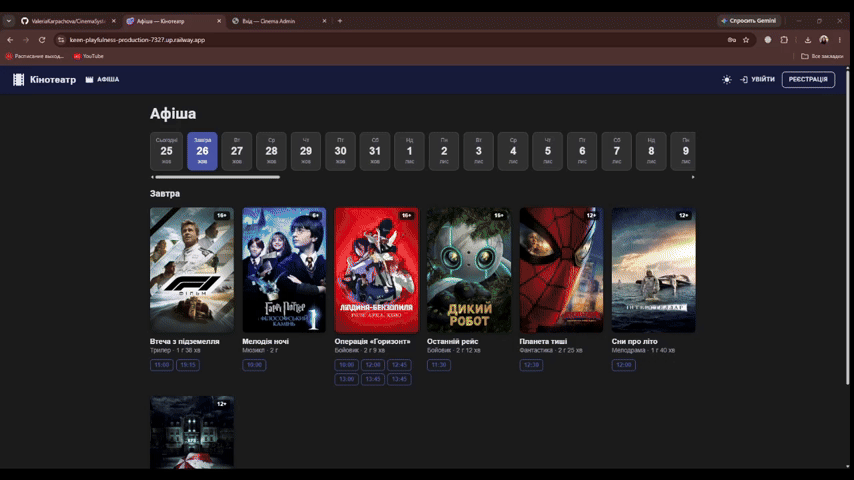

# 🎬 CinemaSystem

A full-stack cinema booking and management platform built with **Blazor Server**, **ASP.NET Core Web API**, **SignalR** and **PostgreSQL**. Started as a database design course project, grown into a portfolio-ready application with real-time seat booking, a JWT-secured REST API, an admin dashboard and SQL-driven analytics.



---

## ✨ Features

### 🎟️ Customer Booking
- Movie listing with search by title and genre, upcoming showtimes per movie
- Interactive seat map per session with four seat states: **free**, **locked** (held by another viewer), **booked**, **sold**
- **Real-time updates via SignalR**: when one viewer selects seats, everyone else sees it instantly, without refreshing the page
- **Atomic multi-seat booking**: all selected seats or none; the price is always taken from the database, never from the client
- Personal ticket history with cancellation of upcoming bookings (a cancelled ticket frees the seat)
- Customer registration and login (JWT); passwords are hashed with ASP.NET Core `PasswordHasher` (PBKDF2)

### 🛠️ Admin Panel
- Full CRUD for movies, genres, halls, seats, sessions, customers, tickets and payments
- Automatic seat-grid generation when creating a hall, with row-based pricing
- Schedule conflict detection: no two sessions in the same hall at the same time
- Friendly error handling for DB-level integrity constraints (no raw SQL errors shown to the user)

### 🔎 Search & Filtering
- Movies by title (partial match) and genre
- Sessions by date and movie
- Tickets by customer and status
- All filtering happens at the query level (`IQueryable` + LINQ), not in memory

### 📊 Analytics & Reports
- Revenue, tickets sold, average ticket price per movie
- Most popular movie, hall occupancy
- Daily revenue with running totals (SQL window functions)
- Raw SQL via **Dapper**, reusing hand-written analytical queries (CTEs, `RANK() OVER`, etc.)

---

## 🧱 Tech Stack

<div align="center">

| Layer | Technology |
|---|---|
| UI | Blazor Server (.NET 10), [MudBlazor](https://mudblazor.com/) |
| Backend | ASP.NET Core Web API, OpenAPI docs via [Scalar](https://scalar.com/) |
| Data access | Entity Framework Core (Npgsql) + Dapper for analytical queries |
| Database | PostgreSQL |
| Real-time | SignalR |
| Auth | Cookie authentication with role-based authorization (admins), JWT bearer (customers) |
| Deployment | Docker, Railway |

</div>

---

## 🏗️ Architecture

Layered solution with a domain-centred dependency flow. Customer pages talk to the backend **only through the REST API**, so the UI can be replaced (for example, by an Angular or React SPA) without touching server logic or the database.

```
Customer pages (Blazor) ── HTTP/JSON + SignalR ──► Cinema.Api ──► Application ──► Infrastructure ──► PostgreSQL
Admin pages    (Blazor) ───────── in-process ─────────────────► Application ──► Infrastructure ──► PostgreSQL
```

```
CinemaSystem.slnx
│
├── Cinema.Domain           Entities, repository interfaces, domain exceptions
├── Cinema.Application      Business logic: services, seat locks, booking, validation
├── Cinema.Infrastructure   EF Core DbContext, repositories, Dapper reports
├── Cinema.Api              REST API, JWT authentication, SignalR hub (SeatHub), OpenAPI
└── Cinema.Web              Blazor Server: admin panel and public customer pages
```

**Dependency rules**
- `Domain` depends on nothing.
- `Application` and `Infrastructure` depend on `Domain` only. `Infrastructure` implements the repository interfaces declared in `Domain`.
- `Api` and `Web` are composition roots: they wire `Application` and `Infrastructure` together.

Database-first approach: the schema was designed and populated directly in PostgreSQL, then scaffolded into C# via EF Core. Database errors (unique, foreign-key violations) are translated into domain exceptions in `Infrastructure`, so `Application` never depends on EF Core or Npgsql.

### REST API

| Method | Endpoint | Purpose | Access |
|---|---|---|---|
| POST | `/api/auth/register` | Register a customer | public |
| POST | `/api/auth/login` | Log in, receive a JWT | public |
| GET | `/api/movies` | Movie listing (search by title, genre) | public |
| GET | `/api/sessions` | Upcoming sessions (filter by movie, date) | public |
| GET | `/api/sessions/{id}/seats` | Seat map with seat states | public |
| POST | `/api/bookings` | Book selected seats (atomic) | customer |
| GET | `/api/me/tickets` | My tickets | customer |
| POST | `/api/me/tickets/{id}/cancel` | Cancel my booking | customer |
| SignalR | `/hubs/seats` | Real-time seat events | viewing: public, locking: customer |

Interactive documentation is available at `/scalar/v1` when the API is running.

---

## 🚀 Live Demo

- **Customer site:** [keen-playfulness-production-7327.up.railway.app](https://keen-playfulness-production-7327.up.railway.app/)
- **Demo credentials:**
  - **Email:** `kidom21138@iconcubic.com`
  - **Password:** `123456789`
>Open the same session in two browser tabs (as two different users) to see seats lock in real time.
- **Admin panel:** [/admin](https://keen-playfulness-production-7327.up.railway.app/admin)
- **Demo credentials:**
  - **Login:** `admin`
  - **Password:** `ChangeMe123!`

>This is a public demo environment with sample data — feel free to register, book tickets, and add, edit, or delete records. Everything resets periodically. It runs on a free tier, so the first request after a period of inactivity can be slow.

---

## 🏃 Running locally

**Prerequisites:** .NET 10 SDK, PostgreSQL 16+

```bash
git clone https://github.com/ValeriaKarpachova/CinemaSystem.git
cd CinemaSystem

# restore a PostgreSQL database named "cinema" using db/schema.sql + db/seed.sql
psql -U postgres -f db/schema.sql
psql -U postgres -f db/seed.sql

# connection string (the same for both projects, kept out of the repository)
dotnet user-secrets init --project Cinema.Api
dotnet user-secrets set "ConnectionStrings:CinemaDb" "Host=localhost;Database=cinema;Username=postgres;Password=yourpassword" --project Cinema.Web
dotnet user-secrets set "ConnectionStrings:CinemaDb" "Host=localhost;Database=cinema;Username=postgres;Password=yourpassword" --project Cinema.Api

# start the API and the web app (two terminals)
dotnet run --project Cinema.Api --launch-profile Local   # http://localhost:5081  (docs: /scalar/v1)
dotnet run --project Cinema.Web --launch-profile Local   # http://localhost:5080
```

Open `http://localhost:5080` for the customer site and `http://localhost:5080/admin` for the admin panel (create your own admin via `/setup-admin` on first run).

### Configuration

| Setting | Where | Purpose |
|---|---|---|
| `ConnectionStrings__CinemaDb` | Web, Api | PostgreSQL connection string |
| `Jwt__Key` | Api | JWT signing key, at least 32 characters (a development key is set in `appsettings.Development.json`) |
| `Api__BaseUrl` | Web | Address of the Cinema.Api service (`http://localhost:5081` in development) |

Secrets are never committed: use user-secrets locally and environment variables in production.

---

## 🗺️ Roadmap

- [ ] Automated tests: xUnit unit tests and integration tests with Testcontainers (including a double-booking scenario)
- [ ] CI/CD pipeline on GitHub Actions: build, test, deploy
- [ ] Test-mode payments (Stripe or LiqPay sandbox)
- [ ] Redis for distributed seat locks and a SignalR backplane
- [ ] SPA client (Angular or React with TypeScript) on top of the existing REST API
